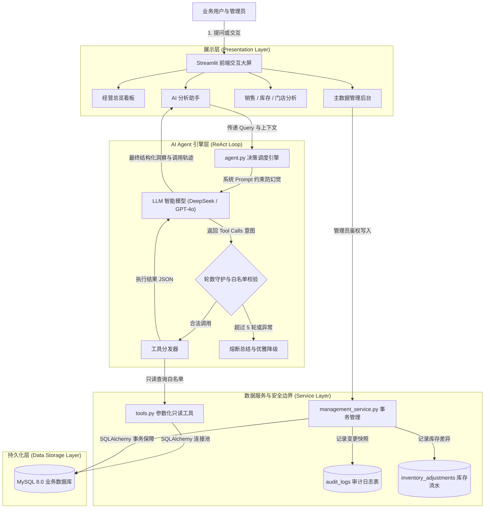

# 📊 AI Business Agent —— 智能商业经营决策与分析系统

[](https://www.python.org/)
[](https://streamlit.io/)
[](https://www.mysql.com/)
[](https://www.docker.com/)
[](https://pytest.org/)
[](LICENSE)

> 一套面向连锁零售与电商经营场景的**生产级智能商业分析系统**。结合 **LLM Tool Calling（ReAct 范式）** 与 **Streamlit + Plotly 数据可视化**，实现“只读白名单工具调用、真实数据防幻觉、事务级主数据治理与全生命周期审计追踪”的企业级技术闭环。

---

## 🌟 核心特性与技术亮点

### 1. 🤖 决策 Agent 与 Tool Calling 协同闭环
- **ReAct 认知流转**：基于 OpenAI Function Calling 协议，Agent 能自主规划并调度多个专业数据工具（销售汇总、品类排行、低库存告警、门店横向对比、周期明细下钻）。
- **复合商业洞察**：模型不仅输出统计事实，还分层次输出 **【核心数据洞察】**、**【经营问题诊断】** 与 **【落地行动对策】**。
- **调用轨迹透明化（Explainability）**：界面支持一键展开查看 Agent 的 Tool Call 入参、返回结构及调用链路（Trace）。

### 2. 🛡️ 严格读写分离与零幻觉保障
- **杜绝 Text-to-SQL 注入**：放弃直接让大模型生成任意 SQL 的高危做法，Agent 仅授予只读数据工具白名单，在参数化查询中彻底杜绝 SQL 注入与全表扫描风险。
- **Prompt 防幻觉约束**：核心 Prompt 严格限制“涉及销售额、毛利、库存等数字必须调用对应工具获取，严禁编造任何数值”，并内置相对日期换算自愈能力。
- **循环与异常熔断保护**：内设 `MAX_ITERATIONS = 5` 最大轮数守护，杜绝死循环；对 API 超时、鉴权失败及限流（429）做优雅降级。

### 3. 🔄 上下文记忆与多轮递进追问
- 支持会话上下文滚动压缩与历史穿透，业务人员可进行自然递进式分析：
  > 👨‍💼 *“最近 7 天哪家门店毛利最高？”*  
  > 🤖 *“华东旗舰店毛利最高，达到 ¥15,240……”*  
  > 👨‍💼 *“那这家店卖得最好的是什么商品？库存还够吗？”* （自动关联上文门店上下文进行多工具串联）

### 4. 🔐 事务级主数据管理与操作审计（Audit Trail）
- **数据治理边界**：写操作与 Agent 彻底隔离，需管理员密码鉴权，经由 `management_service.py` 事务级执行。
- **软删除与数据完整性**：商品、门店、经理采用状态机控制（激活/停用），禁止物理删除破坏外键历史统计。
- **完整流水追踪**：库存调整自动生成变更前、变更后、差异数量流水与审计日志（Audit Logs），支持追溯操作人与快照。

### 5. 🐳 交付级容器编排与工程质量
- 提供 `Dockerfile` 与 `docker-compose.yml`，一键拉起 MySQL 8.0（自动初始化 Schema 与演示数据）与 Streamlit 服务。
- 完善的自动化测试套件（覆盖内存 SQLite 事务 CRUD、软删除规则、Agent Mock 工具流转与异常熔断）。

---

## 🏗️ 系统架构图



---

## 📂 项目目录结构

```text
ai_business_agent_project/
├── .env.example             # 环境变量配置模板
├── .gitignore               # Git 忽略配置（防泄露密钥与敏感文件）
├── Dockerfile               # 生产级 Python 3.11 容器构建文件
├── docker-compose.yml       # 一键编排服务（MySQL 8.0 + Streamlit）
├── requirements.txt         # 项目依赖清单
├── README.md                # 工业级项目说明文档
├── schema.sql               # 数据库表结构与外键索引定义
├── db.py                    # SQLAlchemy 引擎池与数据库健康检查
├── agent.py                 # Agent 核心逻辑（ReAct 循环、守护、异常处理）
├── tools.py                 # 只读数据统计工具集合与 OpenAI Function 定义
├── management_service.py    # 管理端事务服务（CRUD、状态机、审计追踪）
├── seed_demo.py             # 演示数据生成脚本（门店、商品、84+订单流水）
├── app.py                   # Streamlit 主看板与多页面路由
└── tests/                   # 自动化测试套件
    ├── test_agent.py        # Agent Mock 单元测试（工具调度、熔断、异常）
    ├── test_management_service.py # 事务、数据校验、软删除单测
    └── test_tools.py        # 只读工具白名单与参数定义校验
```

---

## 🚀 快速上手与运行

### 方式一：Docker Compose 一键启动（强烈推荐）

无需在本地配置 MySQL 或 Python 环境，只需安装 Docker：

```bash
# 1. 克隆项目并进入目录
git clone https://github.com/your-username/ai_business_agent_project.git
cd ai_business_agent_project

# 2. 从模板复制环境变量，并填入你的 OPENAI_API_KEY
cp .env.example .env
# 编辑 .env，填入 OPENAI_API_KEY=你的密钥

# 3. 一键启动容器集群
docker compose up -d
```

启动完成后：
- 浏览器访问：`http://localhost:8501` 即可体验。
- 数据库端口：`3306`（默认库名 `business_bi`，已预置初始化数据）。
- 管理员默认密码：`admin123456`（可用于进入【资料管理】页）。

---

### 方式二：本地虚拟环境源码启动

#### 1. 环境准备
确保已安装 **Python 3.11+** 与 **MySQL 8.0+**。

```bash
# 创建并激活虚拟环境
python -m venv .venv
# Windows:
.\.venv\Scripts\activate
# Linux/macOS:
source .venv/bin/activate

# 安装完整依赖
pip install -r requirements.txt
```

#### 2. 初始化数据库与配置
```bash
# 复制环境变量配置
cp .env.example .env
# 编辑 .env，配置 MySQL 密码与 LLM API Key

# 导入数据库结构（推荐使用内置 Python 脚本，免配 MySQL 环境变量）
python init_db.py

# 填充模拟业务数据（3 门店、10 商品、84 笔订单流水）
python seed_demo.py
```

#### 3. 运行项目
```bash
streamlit run app.py
```

---

## 🧪 自动化测试

项目基于 `pytest` 构建了完善的单测体系，测试逻辑使用内存数据库与 Mock 技术，**无需连接真实外部 MySQL 或消耗 LLM Token**：

```bash
pytest tests/ -v
```

**测试覆盖矩阵**：
- ✅ `test_agent.py`：测试缺少 Key 阻断、直出文本回答、工具自动调度、非法工具白名单拦截、5 轮死循环截断保护、API 401 鉴权异常降级。
- ✅ `test_management_service.py`：测试表结构幂等升级、经理外键回填、库存调整事务原子性、审计日志落库、商品/门店软删除状态约束。
- ✅ `test_tools.py`：测试工具注册完备性、入参结构规范性、工具只读安全校验。

---

## 💬 典型问答示例（Prompt Examples）

启动后可在【AI 分析助手】中尝试以下问题：

1. **宏观经营盘点**：
   > *“统计最近 7 天各门店销售表现，指出表现最好的一家并给出原因。”*
2. **供应链库存预警**：
   > *“哪些门店商品库存不足？请给出具体的补货建议。”*
3. **多维度明细排查**：
   > *“查询华东旗舰店最近 14 天的畅销商品和毛利分布情况。”*
4. **多轮追问**：
   > 用户：*“最近 7 天总销售额是多少？”*  
   > Agent：*“最近 7 天总销售额为 ¥……”*  
   > 用户：*“那其中贡献最高的是哪个品类？”* （基于历史记忆自动解析意图）

---

## 📄 开源许可

本项目遵循 [MIT License](LICENSE)。欢迎个人学习、简历展示与商业参考。
